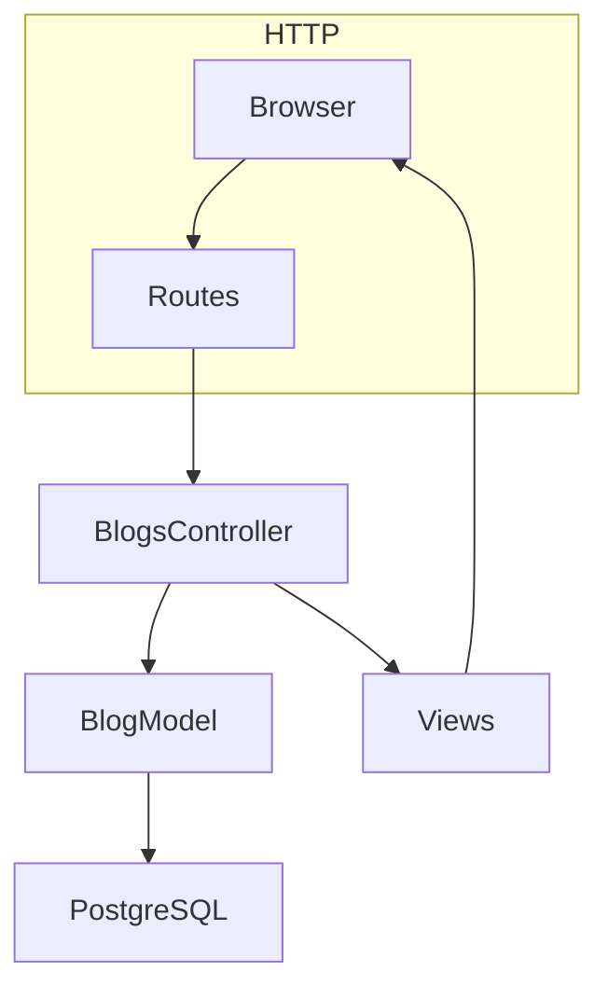
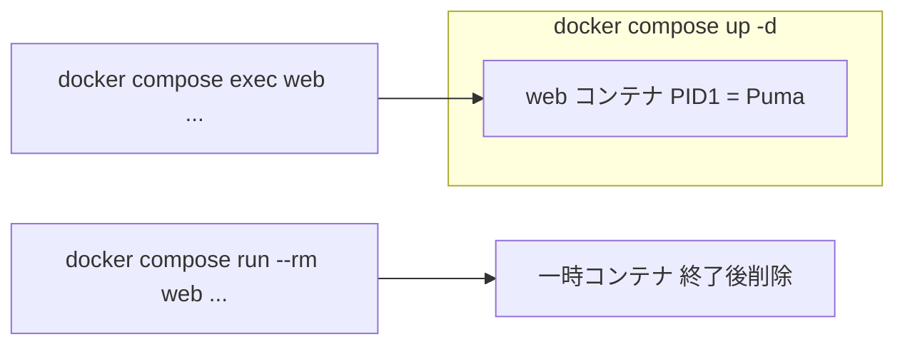

# Blog 手作業チュートリアル（1 コミットずつ）

Hello World 済みの状態から、**scaffold を使わず** Blog のモデル・コントローラー・ビューを自分で書き、**論理削除**・**Bootstrap**・**ダミー 3 件**まで進めます。  
各ステップは **1 コミット** にまとめ、動くことを確認してから次へ進んでください。

## 仕様（README より）

| 項目 | 内容 |
|------|------|
| モデル | `Blog` |
| カラム | `id`, `title`, `post`, `created_at`, `updated_at`, `deleted_at`（`timestamps` で日時 2 列） |
| 操作 | 一覧・詳細・新規・編集・論理削除 |
| 初期データ | seeds で 3 件 |

この章では **Devise（認証）** は扱いません。

## 全体の流れ

```mermaid
flowchart LR
  C1[Commit1 DB接続] --> C2[Commit2 migration]
  C2 --> C3[Commit3 schema]
  C3 --> C4[Commit4 Model]
  C4 --> C5[Commit5 routes]
  C5 --> C6[Commit6 Controller index show]
  C6 --> C7[Commit7 index view]
  C7 --> C8[Commit8 show view]
  C8 --> C9[Commit9 new create]
  C9 --> C10[Commit10 edit update]
  C10 --> C11[Commit11 destroy 論理削除]
  C11 --> C12[Commit12 Bootstrap]
  C12 --> C13[Commit13 seeds 3件]
  C13 --> C14[Commit14 Hello削除]
```





## 運用ルール

- **1 ステップ = 1 コミット**。動かない状態ではコミットしない。
- ファイル編集は **ホストのエディタ**（`docker-compose.yml` の `.:/app` マウント）。開発モードならサーバ再起動は通常不要。
- **長く動かすコマンド**（サーバ）: `docker compose up -d` で起動した `web` に対して **`exec`**。
- **1 回だけ実行するコマンド**（マイグレーションなど）: 同じく **`exec web`** でよい。`run --rm` は別コンテナで実行する点だけ覚えておく（Hello World 章で学んだ内容）。



- DB パスワードは **`.env` にだけ** 書く。`database.yml` や compose に平文で書かない（GitGuardian 対策）。
- `log/`・`tmp/` は `.gitignore` 済み — コミットに含めない。

## 事前準備

```bash
cp .env.example .env   # 未作成なら
docker compose up -d
curl -sS http://localhost:3000   # Hello World
```

---

## Commit 1 — PostgreSQL に Rails を接続する

### やること

1. **`config/database.yml`** — `development` / `test` を compose の `db` サービス向けに書き換える。

`default` に共通接続情報を足し、環境ごとに DB 名だけ変える例:

```yaml
default: &default
  adapter: postgresql
  encoding: unicode
  max_connections: <%= ENV.fetch("RAILS_MAX_THREADS") { 5 } %>
  host: db
  username: <%= ENV["POSTGRES_USER"] %>
  password: <%= ENV["POSTGRES_PASSWORD"] %>
  port: 5432

development:
  <<: *default
  database: <%= ENV.fetch("POSTGRES_DB") { "blog_development" } %>

test:
  <<: *default
  database: blog_test
```

2. **`docker-compose.yml`** — `web` に `.env` を読み込ませる。

```yaml
  web:
    build: .
    env_file:
      - .env
    command: bash -c "rm -f tmp/pids/server.pid && bin/rails server -b 0.0.0.0 -p 3000"
    # ... 以下既存の volumes / ports など
```

3. **`config/environments/development.rb`** — マイグレーション未適用時にページでエラーに戻す。

```ruby
config.active_record.migration_error = :page_load
```

（Hello World 用に `false` にしていた行を上記に戻す。）

4. コンテナを再作成して環境変数を反映する。

```bash
docker compose up -d --force-recreate web
docker compose exec web bin/rails db:prepare
docker compose exec web bin/rails runner 'puts ActiveRecord::Base.connection_db_config.database'
```

期待: `blog_development`（`.env` の `POSTGRES_DB` と一致）。

### コミット

```bash
git add config/database.yml docker-compose.yml config/environments/development.rb
git commit -m "Connect Rails to PostgreSQL via compose db service and .env"
```

---

## Commit 2 — マイグレーションを手で書く（blogs テーブル）

### やること

ファイル名用に generator で空ファイルだけ作り、**中身は自分で書く**。

```bash
docker compose exec web bin/rails generate migration CreateBlogs
```

`db/migrate/XXXXXXXXXXXXXX_create_blogs.rb` を開き、次のようにする:

```ruby
class CreateBlogs < ActiveRecord::Migration[8.1]
  def change
    create_table :blogs do |t|
      t.string :title, null: false
      t.text :post, null: false
      t.datetime :deleted_at

      t.timestamps
    end

    add_index :blogs, :deleted_at
  end
end
```

メモ:

- `id` は Rails が自動で付ける主キー。
- `created_at` / `updated_at` は `t.timestamps` で付く（README の timestamp に相当）。

### コミット

**まだ `db:migrate` は実行しない**（次のコミットで schema と一緒に）。

```bash
git add db/migrate/*_create_blogs.rb
git commit -m "Add migration for blogs table with soft delete column"
```

---

## Commit 3 — マイグレーション実行と schema をコミット

```bash
docker compose exec web bin/rails db:migrate
docker compose exec web bin/rails runner 'puts ActiveRecord::Base.connection.table_exists?(:blogs)'
```

期待: `true`

### コミット

```bash
git add db/migrate db/schema.rb
git commit -m "Run blogs migration and update schema"
```

---

## Commit 4 — Blog モデル（手書き）

`app/models/blog.rb` を新規作成:

```ruby
class Blog < ApplicationRecord
  validates :title, :post, presence: true

  scope :active, -> { where(deleted_at: nil) }

  def soft_delete!
    update!(deleted_at: Time.current)
  end
end
```

確認:

```bash
docker compose exec web bin/rails runner 'b = Blog.new; puts b.valid?; puts b.errors.full_messages'
```

期待: `false` とバリデーションエラー（空のため）。

### コミット

```bash
git add app/models/blog.rb
git commit -m "Add Blog model with validations and active scope"
```

---

## Commit 5 — ルーティング

`config/routes.rb` の `draw` ブロック内:

```ruby
resources :blogs
root "blogs#index"
```

`root "hello#index"` を **`root "blogs#index"` に差し替える**（`root` は 1 つだけ）。  
`HelloController` ファイルは Commit 14 まで残してよいが、`/` は Blog 一覧になる。

### コミット

```bash
git add config/routes.rb
git commit -m "Add blogs routes and set root to blogs index"
```

---

## Commit 6 — BlogsController（index / show）

`app/controllers/blogs_controller.rb` を新規作成:

```ruby
class BlogsController < ApplicationController
  before_action :set_blog, only: %i[show edit update destroy]

  def index
    @blogs = Blog.active.order(created_at: :desc)
  end

  def show
  end

  private

  def set_blog
    @blog = Blog.active.find(params[:id])
  end
end
```

確認（ビューが無いとエラーになるので Commit 7 以降でブラウザ確認）。

```bash
docker compose exec web bin/rails routes | grep blogs
```

### コミット

```bash
git add app/controllers/blogs_controller.rb
git commit -m "Add BlogsController with index and show actions"
```

---

## Commit 7 — index ビュー

`app/views/blogs/index.html.erb`:

```erb
<h1>Blog 一覧</h1>

<p><%= link_to "新規作成", new_blog_path %></p>

<ul>
  <% @blogs.each do |blog| %>
    <li>
      <%= link_to blog.title, blog_path(blog) %>
      <small>(<%= l blog.created_at, format: :long %>)</small>
    </li>
  <% end %>
</ul>

<% if @blogs.empty? %>
  <p>記事がありません。</p>
<% end %>
```

確認:

```bash
# ブラウザ http://localhost:3000/
# または
curl -sS http://localhost:3000/ | head
```

### コミット

```bash
git add app/views/blogs/index.html.erb
git commit -m "Add blogs index view"
```

---

## Commit 8 — show ビュー

`app/views/blogs/show.html.erb`:

```erb
<h1><%= @blog.title %></h1>

<p><%= simple_format @blog.post %></p>

<p>
  <small>作成: <%= l @blog.created_at, format: :long %></small>
  <% if @blog.updated_at != @blog.created_at %>
    <br>
    <small>更新: <%= l @blog.updated_at, format: :long %></small>
  <% end %>
</p>

<p>
  <%= link_to "一覧へ", blogs_path %>
  <%= link_to "編集", edit_blog_path(@blog) %>
</p>
```

（削除ボタンは Commit 11 で追加。）

### コミット

```bash
git add app/views/blogs/show.html.erb
git commit -m "Add blogs show view"
```

---

## Commit 9 — new / create

### コントローラ

`BlogsController` に追加:

```ruby
  def new
    @blog = Blog.new
  end

  def create
    @blog = Blog.new(blog_params)
    if @blog.save
      redirect_to @blog, notice: "Blog を作成しました。"
    else
      render :new, status: :unprocessable_entity
    end
  end

  private

  def blog_params
    params.require(:blog).permit(:title, :post)
  end
```

（`private` はファイル末尾に 1 つ。`set_blog` と `blog_params` を同じ `private` 下に置く。）

### ビュー

`app/views/blogs/_form.html.erb`:

```erb
<%= form_with model: blog do |f| %>
  <% if blog.errors.any? %>
    <ul>
      <% blog.errors.full_messages.each do |message| %>
        <li><%= message %></li>
      <% end %>
    </ul>
  <% end %>

  <p>
    <%= f.label :title, "タイトル" %><br>
    <%= f.text_field :title %>
  </p>

  <p>
    <%= f.label :post, "本文" %><br>
    <%= f.text_area :post, rows: 10 %>
  </p>

  <p><%= f.submit %></p>
<% end %>
```

`app/views/blogs/new.html.erb`:

```erb
<h1>新規 Blog</h1>

<%= render "form", blog: @blog %>

<p><%= link_to "一覧へ", blogs_path %></p>
```

確認: ブラウザで 1 件作成 → 詳細ページへリダイレクト。

### コミット

```bash
git add app/controllers/blogs_controller.rb app/views/blogs/new.html.erb app/views/blogs/_form.html.erb
git commit -m "Add new and create actions with form partial"
```

---

## Commit 10 — edit / update

### コントローラ

```ruby
  def edit
  end

  def update
    if @blog.update(blog_params)
      redirect_to @blog, notice: "Blog を更新しました。"
    else
      render :edit, status: :unprocessable_entity
    end
  end
```

### ビュー

`app/views/blogs/edit.html.erb`:

```erb
<h1>Blog 編集</h1>

<%= render "form", blog: @blog %>

<p><%= link_to "詳細へ", blog_path(@blog) %> | <%= link_to "一覧へ", blogs_path %></p>
```

### コミット

```bash
git add app/controllers/blogs_controller.rb app/views/blogs/edit.html.erb
git commit -m "Add edit and update actions for blogs"
```

---

## Commit 11 — destroy（論理削除）

### コントローラ

```ruby
  def destroy
    @blog.soft_delete!
    redirect_to blogs_path, notice: "Blog を削除しました。"
  end
```

`set_blog` は `Blog.active.find` のままなので、既に削除済みの ID は 404 になる。

### show ビューに削除ボタン

`app/views/blogs/show.html.erb` のリンク群に追加:

```erb
<%= button_to "削除", blog_path(@blog), method: :delete, data: { turbo_confirm: "削除しますか？" } %>
```

確認:

1. 1 件作成 → 詳細で削除
2. 一覧に戻り、その記事が消えている
3. `docker compose exec web bin/rails runner 'puts Blog.count; puts Blog.active.count'`
   - 行は DB に残り `deleted_at` が入る（物理削除ではない）

### コミット

```bash
git add app/controllers/blogs_controller.rb app/views/blogs/show.html.erb
git commit -m "Implement soft delete for blogs"
```

---

## Commit 12 — Bootstrap をレイアウトに載せる

importmap を増やさず **Bootstrap 5 CDN**（CSS のみ）で整える。

### `app/views/layouts/application.html.erb`

`<head>` 内、`stylesheet_link_tag` の前後などに CDN を追加:

```erb
<link href="https://cdn.jsdelivr.net/npm/bootstrap@5.3.3/dist/css/bootstrap.min.css" rel="stylesheet" integrity="sha384-QWTKZyjpPEjISv5WaRU9OFeRpok6YctnYmDr5pNlyT2bRjXh0JMhjY6hW+ALEwIH" crossorigin="anonymous">
```

`<body>` を例えば:

```erb
<body>
  <nav class="navbar navbar-expand-lg navbar-dark bg-dark mb-4">
    <div class="container">
      <%= link_to "rails8_blog_app", root_path, class: "navbar-brand" %>
    </div>
  </nav>
  <main class="container">
    <% if notice.present? %>
      <div class="alert alert-success"><%= notice %></div>
    <% end %>
    <% if alert.present? %>
      <div class="alert alert-danger"><%= alert %></div>
    <% end %>
    <%= yield %>
  </main>
</body>
```

### 各 Blog ビューを Bootstrap 化（例）

**index** — テーブル:

```erb
<h1 class="mb-3">Blog 一覧</h1>
<%= link_to "新規作成", new_blog_path, class: "btn btn-primary mb-3" %>

<table class="table table-striped">
  <thead>
    <tr><th>タイトル</th><th>作成日時</th></tr>
  </thead>
  <tbody>
    <% @blogs.each do |blog| %>
      <tr>
        <td><%= link_to blog.title, blog_path(blog) %></td>
        <td><%= l blog.created_at, format: :short %></td>
      </tr>
    <% end %>
  </tbody>
</table>
```

**show** — `card`、`btn btn-outline-secondary` / `btn btn-danger` など。

**\_form** — `form-control`, `btn btn-primary`。

### `app/assets/stylesheets/application.css`

必要なら最小追記:

```css
/* Blog 本文の余白 */
.card-body p:last-child {
  margin-bottom: 0;
}
```

### コミット

```bash
git add app/views/layouts/application.html.erb app/views/blogs/ app/assets/stylesheets/application.css
git commit -m "Apply Bootstrap layout and style blog views"
```

---

## Commit 13 — ダミーデータ 3 件（seeds）

`db/seeds.rb` を次の内容に（**何度実行しても 3 件**になるよう `find_or_create_by!`）:

```ruby
blogs = [
  {
    title: "Docker compose 学習メモ",
    post: "exec は起動中コンテナにプロセスを足す。run は一時コンテナで 1 回だけコマンドを実行する。"
  },
  {
    title: "Rails 8 Hello World",
    post: "コンテナでは PID 1 がサーバプロセス。Puma をフォアグラウンドで動かし、0.0.0.0 で待ち受ける。"
  },
  {
    title: "Blog CRUD 完成",
    post: "論理削除は deleted_at をセットする。一覧は Blog.active で削除済みを除く。seeds で 3 件投入。"
  }
]

blogs.each do |attrs|
  Blog.active.find_or_create_by!(title: attrs[:title]) do |blog|
    blog.post = attrs[:post]
  end
end

puts "Seeded #{Blog.active.count} blogs"
```

実行:

```bash
docker compose exec web bin/rails db:seed
docker compose exec web bin/rails runner 'puts Blog.active.count'
```

期待: `3`

ブラウザ `http://localhost:3000/` で 3 件表示。

### コミット

```bash
git add db/seeds.rb
git commit -m "Seed three sample blog records"
```

---

## Commit 14 — Hello World の片付け

不要になった Hello World を削除する。

```bash
rm app/controllers/hello_controller.rb
```

`config/routes.rb` に `hello` 関連が残っていないこと、`root` が `blogs#index` のみであることを確認。

```bash
curl -sS http://localhost:3000/ | grep -E "Blog|一覧" || true
```

### コミット

```bash
git rm app/controllers/hello_controller.rb
git add config/routes.rb
git commit -m "Remove Hello World controller after blogs root is in place"
```

---

## 完了チェックリスト

- [ ] `docker compose ps` で `web` / `db` が Up
- [ ] `/` に Blog 一覧（Bootstrap 付き）
- [ ] 新規・編集・論理削除が動く
- [ ] `Blog.active.count` が seeds 後 **3**
- [ ] コミットが **14 個**（または自分で分割した数）で履歴が読める
- [ ] `.env` / `config/master.key` をコミットしていない

## よくあるエラー

| 症状 | 原因 | 対処 |
|------|------|------|
| `connection to server on socket` | `host: db` 未設定 or `web` に `.env` なし | Commit 1 を再確認、`docker compose up -d --force-recreate web` |
| `database "app_development" does not exist` | DB 名が `.env` と不一致 | `database.yml` の `POSTGRES_DB` と `db:prepare` |
| Pending migration | マイグレーション未実行 | `bin/rails db:migrate` |
| `uninitialized constant BlogsController` | ファイル名・クラス名 typo | `blogs_controller.rb` / `BlogsController` |
| 削除しても一覧に残る | 物理 `destroy` している | `soft_delete!` と `Blog.active` |
| GitGuardian 失敗 | YAML にパスワード直書き | `.env` のみ、`.env.example` は `change_me` |

## 次の章

- [Devise チュートリアル（Blog 所有者）](devise_tutorial.md)

## その他（スコープ外）

- `config/database.yml` の本番向け調整
- paranoia gem
- GitHub Actions CI
