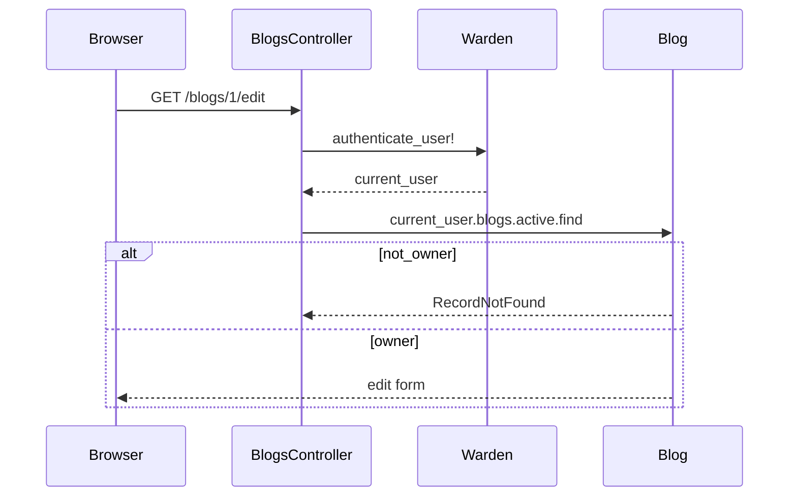

# Devise チュートリアル（Blog 所有者）

README の **Auth: Devise** を満たす章です。Blog CRUD（[blog_tutorial.md](blog_tutorial.md)）のあとに進めます。

## Devise とは

**Devise** は Rails 向けの認証 gem です（README の「Device」は Devise の誤記）。メールアドレスとパスワードによる **サインアップ・ログイン・ログアウト・パスワード再設定** などを、少ない設定で提供します。

内部では **Warden** という Rack ミドルウェアがセッションを管理します。ログインに成功すると cookie にユーザー ID が保存され、以降のリクエストで `current_user` として参照できます。

### 今回有効にしたモジュール（User モデル）

| モジュール | 役割 |
|-----------|------|
| `:database_authenticatable` | email + 暗号化 password で DB 認証 |
| `:registerable` | 新規登録 |
| `:recoverable` | パスワードリセットメール（development では主にログ） |
| `:rememberable` | ログイン状態を長く保持 |
| `:validatable` | email 形式・password 長などのバリデーション |

### 認可の設計（このアプリ）

| 操作 | 条件 |
|------|------|
| 一覧・詳細 | 未ログインでも可 |
| 新規・作成 | ログイン必須。`current_user.blogs.build` |
| 編集・更新・論理削除 | ログイン必須かつ **記事の `user_id` が本人** |



## 追加・変更される主なファイル

| パス | 内容 |
|------|------|
| `Gemfile` | `gem "devise"` |
| `config/initializers/devise.rb` | Devise 全体設定 |
| `config/locales/devise.en.yml` | メッセージ（英語） |
| `app/models/user.rb` | Devise モジュール、`has_many :blogs` |
| `db/migrate/*_devise_create_users.rb` | users テーブル |
| `db/migrate/*_add_user_to_blogs.rb` | blogs.user_id + 既存行の backfill |
| `config/routes.rb` | `devise_for :users` |
| `app/controllers/blogs_controller.rb` | ログイン・所有者チェック |
| `app/views/devise/**` | ログイン・登録画面（Bootstrap） |
| `app/views/layouts/application.html.erb` | navbar にログイン/ログアウト |

## Docker での導入コマンド

```bash
docker compose up -d
docker compose exec web bundle install
docker compose exec web bin/rails generate devise:install
docker compose exec web bin/rails generate devise User
docker compose exec web bin/rails db:migrate
docker compose exec web bin/rails generate devise:views
```

`development.rb` には既に次があることを確認（Devise のメール URL 用）:

```ruby
config.action_mailer.default_url_options = { host: "localhost", port: 3000 }
```

## 推奨コミット（8 段）

### Commit 1 — Gem

```bash
# Gemfile に gem "devise"
docker compose exec web bundle install
git add Gemfile Gemfile.lock
git commit -m "Add devise gem for user authentication"
```

### Commit 2 — devise:install

```bash
docker compose exec web bin/rails generate devise:install
git add config/initializers/devise.rb config/locales/devise.en.yml
git commit -m "Run devise install generator"
```

### Commit 3 — User モデル

```bash
docker compose exec web bin/rails generate devise User
docker compose exec web bin/rails db:migrate
git add app/models/user.rb db/migrate db/schema.rb config/routes.rb test/
git commit -m "Add Devise User model and users table"
```

### Commit 4 — Blog に user_id

マイグレーションで `null: true` → 既存 Blog を demo ユーザーに紐付け → `null: false`。

```bash
docker compose exec web bin/rails db:migrate
git add db/migrate db/schema.rb app/models/blog.rb app/models/user.rb
git commit -m "Add blog ownership with user_id foreign key"
```

### Commit 5 — ルートと BlogsController 認可

- `before_action :authenticate_user!, except: %i[index show]`
- `current_user.blogs.active.find` で編集・削除

```bash
git add app/controllers/blogs_controller.rb
git commit -m "Require login for blog mutations and enforce ownership"
```

### Commit 6 — ビューと navbar

Blog 一覧・詳細のボタン表示、layout のログインリンク。

```bash
git add app/views/blogs app/views/layouts/application.html.erb
git commit -m "Update blog views and navbar for authenticated users"
```

### Commit 7 — Devise ビュー（Bootstrap）

```bash
docker compose exec web bin/rails generate devise:views
# sessions/new, registrations/new を Bootstrap 化
git add app/views/devise
git commit -m "Style Devise sign-in and sign-up with Bootstrap"
```

### Commit 8 — seeds

デモユーザー（**開発専用**）:

| 項目 | 値 |
|------|-----|
| email | `demo@example.com` |
| password | `.env` の `DEMO_USER_PASSWORD`（例: `.env.example` をコピーして設定） |

```bash
docker compose exec web bin/rails db:seed
git add db/seeds.rb
git commit -m "Seed demo user and assign blogs"
```

## 動作確認

```bash
docker compose exec web bin/rails db:seed
open http://localhost:3000/
open http://localhost:3000/users/sign_in
```

チェックリスト:

- [ ] 未ログインで一覧・詳細が見える
- [ ] 未ログインで `/blogs/new` → ログインへリダイレクト
- [ ] `demo@example.com` と `.env` の `DEMO_USER_PASSWORD` でログインできる
- [ ] 自分の記事だけ編集・削除ボタンが出る
- [ ] 他人の記事の `/blogs/:id/edit` は 404（`ActiveRecord::RecordNotFound`）

## トラブルシュート

| 症状 | 対処 |
|------|------|
| `service "web" is not running` | `docker compose up -d web` → `docker compose logs web` |
| `config` NameError in environment.rb | `migration_error` 等は `development.rb` の `configure` ブロック内だけ |
| ログインできない | seeds 再実行、password 6 文字以上（validatable） |
| GitGuardian | パスワードを YAML に書かない。seeds の開発用パスワードは本番禁止と README に明記 |

## 次の章（スコープ外）

- OAuth（Google 等）
- 管理者ロール
- 本番メール（SMTP）設定
